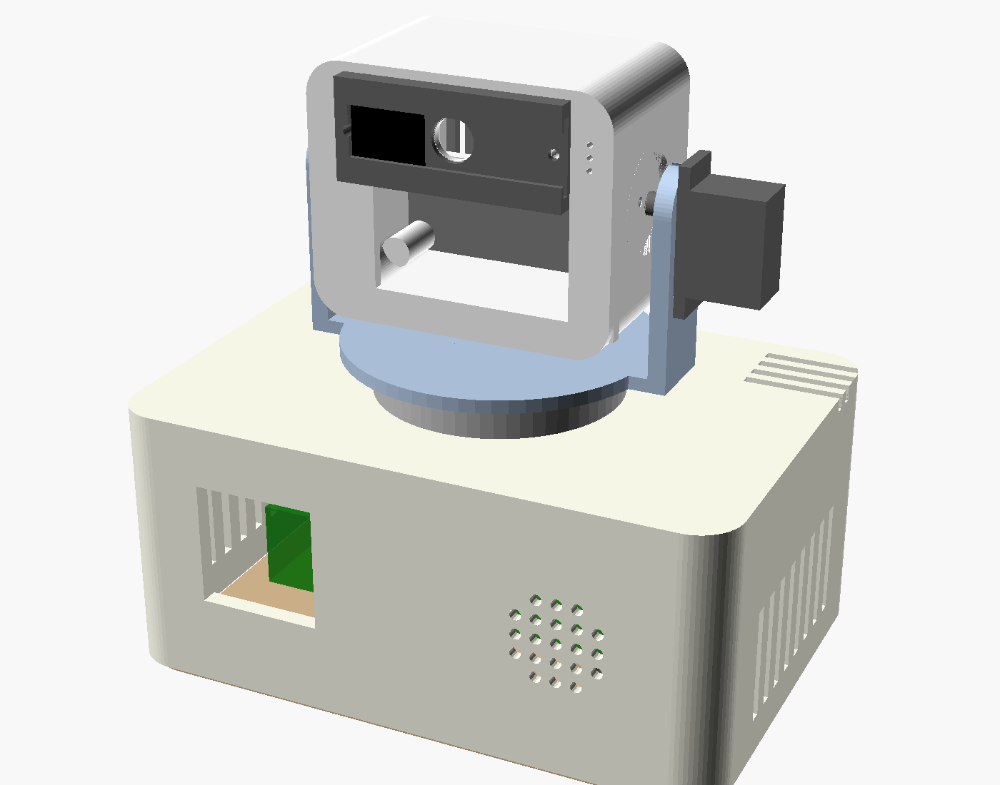

# KIRA PRO — Tasarım Belgesi (v0.1, taslak)

> Bu, orijinal KIRA'dan bağımsız **yeni** bir tasarımdır. Orijinal firmware/STL/3MF dosyalarına dokunulmaz.
> 3D model: `hardware/kira_pro/kira_pro.scad` (parametrik) · Önizlemeler: `hardware/kira_pro/preview_*.png`
> **Henüz hiçbir parça basılmadı ve gerçek donanımda denenmedi.** "ÖLÇ" yazan ölçüler kumpasla doğrulanmalı.



## 1. Hedefler

| İstek | Çözüm |
|---|---|
| Baş hareket etsin, sağa-sola/yukarı-aşağı baksın | 2 servolu pan/tilt boyun: pan ±60°, tilt ±30° |
| Kendine özgü karakter | Robot üstünde çalışan **kişilik motoru**: duygu durumu, yüz ifadeleri, baş hareketleri, sesler |
| İnternet olmadan da çalışsın | 3 çalışma modu (aşağıda). Robot PC'siz bile "canlı" kalır |
| PC'ye erişimi olsun | PC açıksa KIRA onu "ek beyin" ve "eller" olarak kullanır (sohbet, hafıza, Windows işlemleri) |

## 2. Üç çalışma modu (v0.2: robotun kendi beyni — Raspberry Pi 5)

> v0.2 değişikliği: Kullanıcı isteğiyle **internet ve PC kapalıyken de sohbet** için gövdeye Raspberry Pi 5 (8 GB) eklendi. Gövde 140×96×62 mm'ye büyütüldü; Pi'nin USB-C güç portu arka duvardan doğrudan erişilir.

| Mod | Ne zaman | KIRA ne yapar |
|---|---|---|
| **A. Tek başına** | PC kapalı, internet yok | Pi 5 üzerinde: "Hey KIRA" uyanma, Türkçe konuşma tanıma, küçük yerel dil modeliyle **serbest sohbet**, Türkçe sesli cevap, hafıza, yüz ifadeleri, baş takibi |
| **B. Ev ağı** | PC açık | A + karmaşık sorular PC'deki daha büyük modele gider, Windows işlemleri |
| **C. Tam** | İnternet var | B + bulut AI |

Yönlendirme sırası (kodda uygulandı, `windows/kira/ai/router.py`): basit sohbet **robot → PC → bulut**, karmaşık iş **bulut → PC → robot**.

**Dürüst beklenti (Pi 5'te ölçülecek):** küçük modeller (3B civarı) kısa sohbette makul ama büyük modeller kadar akıllı değildir; cevap başlangıcı birkaç saniye sürebilir. Görüntü hakkında soru Pi'de yavaştır, PC/bulut tercih edilir.

## 3. Donanım dağılımı

```
                 ┌──────────────── BAŞ (tilt) ────────────────┐
                 │  [Kamera]   XIAO ESP32-S3 Sense            │
                 │     │        • kamera, PDM mikrofon         │
                 │     └──────► • insan/hareket algılama       │
                 │              • (ileride) "Hey KIRA"         │
                 │                 │ UART                     │
                 │  LILYGO T-Display-S3  ◄── ANA KONTROLCÜ    │
                 │  • renkli yüz (1.9")  • kişilik motoru     │
                 │  • 2 tuş              • servo, ses, OLED   │
                 │  • Wi-Fi ↔ PC                              │
                 └──────────────┬─────────────────────────────┘
                     boyun kablosu (9-10 damar, servis halkalı)
                 ┌──────────────┴──────── GÖVDE (base) ───────┐
                 │  USB-C 5V 3A giriş → sarı breadboard (5V/GND dağıtımı)
                 │  Pan servo (gövdede)   MAX98357A → hoparlör
                 │  SH1107 OLED (durum ekranı)                │
                 └────────────────────────────────────────────┘
```

**Neden T-Display-S3 ana kontrolcü?** XIAO kamera akışı ve görüntü işlemeyle meşgulken yüz animasyonu, servo ve ses akıcı kalsın diye. XIAO'nun kamerası kısa FPC kabloyla bağlı olduğu için XIAO kamerayla birlikte **başta** durmak zorundadır.

**Neden mikrofon başta, hoparlör gövdede?** Aralarındaki mesafe yankıyı azaltır ve söz kesmeyi kolaylaştırır.

## 4. Eksik donanım (satın alınması gerekenler)

| Parça | Adet | Neden | Not |
|---|---|---|---|
| **MG90S mikro servo** (metal dişli) | 2 | Pan ve tilt | SG90 da olur ama dişlisi çabuk aşınır |
| **Raspberry Pi 5 (8 GB)** + resmi aktif soğutucu + microSD (32 GB+) | 1 | Robotun kendi beyni (internetsiz sohbet) | |
| **Resmi Raspberry Pi 27W USB-C adaptör** | 1 | Pi gücü | |
| **5V 3A adaptör + 5.5×2.1 panel DC jak** | 1 | Servo, ses, ekranlar | Pi ile GND ortak |
| **1000 µF 10V elektrolitik kondansatör** | 1 | Servo çekişinde voltaj düşmesini önler | Breadboard 5V-GND arasına |
| **Silikon kablo** (26-28 AWG, 8 renk) veya ince çok damarlı kablo | 1 m | Boyundan geçen kablo demeti | Jumper kablolar hareketle çıkar |
| M2 vida (6-8 mm) ×10, M3 vida (12 mm) ×6 | — | Montaj | |
| PTFE bant (isteğe bağlı) | — | Döner tabla sürtünmesi | |

Elinizdeki parçalardan **hepsi kullanılıyor**: XIAO Sense + kamera, T-Display-S3, SH1107, MAX98357A, hoparlör, sarı breadboard, jumperlar.

## 5. Bağlantı planı — ÖNERİ (kartlar üzerinde doğrulanacak)

> Pin numaraları üreticilerin genel pin haritalarına göre önerilmiştir. **LILYGO'nun kendi pin şeması ve kartınızın üzerindeki baskı ile karşılaştırılmadan bağlamayın.** Orijinal KIRA R02 şeması gelince, ortak modüllerin (OLED, MAX98357A) bağlantısı onunla da karşılaştırılacak.

### 5.1 T-Display-S3 (ana kontrolcü)

| Sinyal | T-Display-S3 GPIO | Gider |
|---|---|---|
| I2S BCLK | 1 | MAX98357A BCLK (gövde) |
| I2S LRC/WS | 2 | MAX98357A LRC (gövde) |
| I2S DATA | 3 | MAX98357A DIN (gövde) |
| AMP aç/kapa | 10 | MAX98357A SD (gövde) |
| I2C SDA | 11 | SH1107 SDA (gövde) |
| I2C SCL | 12 | SH1107 SCL (gövde) |
| Pan servo sinyali | 13 | Pan servo (gövde) |
| Tilt servo sinyali | 16 | Tilt servo (baş/çatal) |
| UART TX | 17 | XIAO RX (D1) |
| UART RX | 18 | XIAO TX (D0) |
| Yedek | 21, 43, 44 | ileride sensör / RGB LED |
| Dahili (dokunma) | LCD, tuşlar (GPIO0, 14), LCD güç (GPIO15) | — |

### 5.2 XIAO ESP32-S3 Sense (göz-kulak)

| Sinyal | XIAO pini | Not |
|---|---|---|
| UART TX | D0 (GPIO1) | → T-Display GPIO18 |
| UART RX | D1 (GPIO2) | ← T-Display GPIO17 |
| Kamera, mikrofon | dahili | dış pin kullanmaz |

### 5.3 Boyun kablo demeti (9-10 damar)

`5V · GND · BCLK · LRC · DIN · AMP_SD · SDA · SCL · PAN_SERVO` = 9 damar. SH1107 modülü 3.3 V ile beslenecekse + `3V3` = 10 damar.
(Tilt servo çatalın üstünde olduğundan kablosu doğrudan başa gider.) Kablo, döner tablanın arkasındaki delikten ve gövde üstündeki yay şeklindeki yarıktan geçer; pan ±60° için **servis halkası** bırakılır.

### 5.4 Güç dağıtımı (sarı breadboard, gövdede)

| Breadboard sütunu | Ağ | Bağlananlar |
|---|---|---|
| A | **5V** | USB-C girişi (+) → servo kırmızılar → MAX98357A Vin → boyun 5V → kondansatör (+) |
| B | **GND** | USB-C girişi (−) → servo kahverengiler → MAX98357A GND → OLED GND → boyun GND → kondansatör (−) |
| C | 3V3 | T-Display 3V3 (boyundan) → SH1107 VCC *(modül 3.3 V uyumluysa)* |

⚠️ **Geri besleme uyarısı:** Kartlara harici 5V verilirken aynı anda bilgisayardan USB ile programlama yapmayın; önce harici gücü çekin. (Kartların 5V pininde koruma diyotu olup olmadığı doğrulanacak.)

## 6. Kişilik motoru (T-Display-S3 üzerinde, internetsiz)

KIRA'nın karakteri tek yerde, PC'ye bağlı olmadan yaşar:

- **İç durum:** enerji (uyku ↔ dinç), merak, ruh hali, sosyal ihtiyaç. Zamanla ve olaylarla değişir.
- **Davranışlar:** biri gelince başını çevirip bakar ve selamlar; uzun süre kimse yoksa uyuklar; ani hareket görürse irkilir; boşta etrafa bakınır; sevildiğinde (tuşa basılınca) mutlu ifade.
- **Yüz:** renkli ekranda göz kırpma, bakış yönü (baş hareketiyle uyumlu), mutlu / meraklı / uykulu / şaşkın / düşünüyor / dinliyor / konuşuyor ifadeleri.
- **Ses:** karakter sesleri + PC'de bir kez üretilip flash'a kaydedilen Türkçe cümleler ("Günaydın!", "Seni gördüm", "Biraz kestireceğim"…). PC bağlıyken cümleler PC'deki TTS ile serbestçe üretilir.
- **PC bağlıyken:** PC'deki büyük model konuşmanın içeriğini üretir, kişilik motoru aynı karakterle ifade ve hareketi uygular → tek bir KIRA hissi.
- **Hafıza:** Uzun süreli hafıza PC'de (SQLite). Robot, son ayarları ve yaklaşan hatırlatmaları kendi flash'ında tutar; PC kapalıyken de hatırlatabilir.

## 7. Gizlilik

- Kayar fiziksel kamera kapağı (ayrı parça: `shutter_frame` + `shutter`).
- Kamera/mikrofon açıkken OLED'de ve yüzde gösterge; T-Display tuşlarından biri **mikrofon kapat**, diğeri **kamera kapat** olarak atanabilir.
- Mod A'da görüntü cihazdan hiç çıkmaz; yalnızca "insan var, şu yönde" bilgisi üretilir.

## 8. 3D baskı

| Parça | Ölçü (mm) | Yön | Not |
|---|---|---|---|
| `base` | 100×80×50 | Üst yüzü yatakta | Destek gerekmez |
| `bottom` | 95×75×2.4 | Düz | 4× M3 ile kapanır |
| `pan_ring` | Ø56×8.6 | Düz | Gövde üstüne yapıştırılır |
| `turntable` | 84×70×47 | Disk yatakta | Pan servo koluna vidalanır |
| `head` | 68×56×42 | Ön yüz yatakta | Ekran penceresi kenarında küçük köprü olabilir |
| `head_back` | 63×51×2.4 | Düz | 4× M2 |
| `shutter_frame` | 50×22×4.2 | Arka yüz yatakta | 2× M2 ile başa |
| `shutter` | 16×15×4 | Düz | Çerçeveye sağdan takılır |

Malzeme: PLA veya PETG, %15-20 doluluk, 0.2 mm katman. STL'ler `hardware/kira_pro/stl/` altında; ölçüleri değiştirmek için `.scad` dosyasının başındaki parametreleri düzenleyip yeniden dışa aktarın.

**Baskıdan önce ölçülmesi gerekenler:** servo gövdesi ve kulakçıkları, servo kolu çapı, T-Display-S3 kartı ve LCD'nin karta göre konumu, kamera lens çapı ve modül boyutu, XIAO mikrofon deliğinin konumu, hoparlör çapı, SH1107 modül ve pencere ölçüsü. Önce `shutter_frame` ve `shutter` gibi küçük parçaları basıp toleransı doğrulayın.

## 9. Montaj sırası (taslak)

1. Breadboard'u gövde tabanına yapıştır, 5V/GND/3V3 sütunlarını kur, multimetreyle kontrol et.
2. USB-C girişi, kondansatör, MAX98357A + hoparlör, SH1107 → gövde.
3. Pan servoyu üst plakaya vidala, servoyu **90° ortaya** alıp kolu tak, `pan_ring`'i yapıştır, döner tablayı kola vidala.
4. Tilt servoyu sağ kola vidala (90° ortada).
5. T-Display-S3'ü ekran penceresine, kamerayı lens cebine, XIAO'yu arkasına yerleştir.
6. Başı tilt servo koluna (sağ) ve M3 mile (sol) bağla.
7. Boyun kablosunu servis halkasıyla geçir, `head_back` ve `bottom` kapaklarını kapat.
8. Kamera kapağı çerçevesini tak.

## 10. Sonraki yazılım adımları

1. **Protokol belgesi:** T-Display ↔ XIAO (UART) ve robot ↔ PC (Wi-Fi) mesajları.
2. **T-Display firmware v0:** yüz animasyonları + servo kontrolü + kişilik motoru iskeleti (donanımsız simülatörle test edilebilir).
3. **XIAO firmware v0:** kamera akışı + hareket algılama + yön bilgisini UART'a gönderme.
4. **PC tarafı:** mevcut `windows/kira` çekirdeğine robot bağlantısı.
